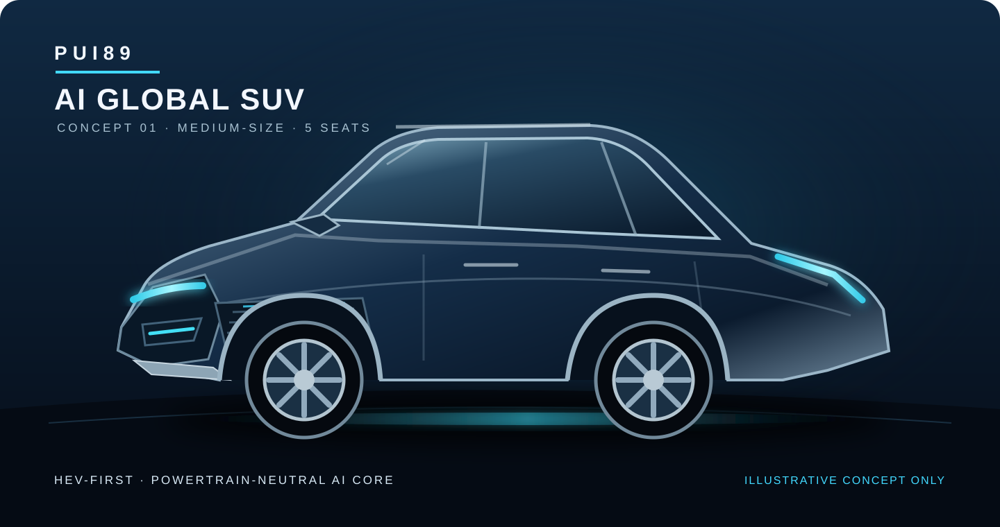

# PUI89 AI Global SUV

**Intelligent mobility. Global-market thinking. Evidence-led safety.**

PUI89 AI Global SUV is a software-first vehicle-intelligence research concept for a **medium-size, five-door SUV**. The design direction prioritizes practical passenger and cargo space, all-weather usability, global-market adaptability and risk-aware driver support. It is not a small city car.

## Product direction

| Dimension | Current direction | Evidence boundary |
|---|---|---|
| Official project name | **PUI89 AI Global SUV** | Confirmed project identity |
| Vehicle class | Medium-size SUV, five-door | Design direction; no production vehicle selected |
| Initial powertrain study | **HEV-first** (full hybrid preferred for initial evaluation) | No supplier, drivetrain or vehicle platform selected |
| AI architecture | PUI89 Shared AI Core | Software-first; advisory only |
| Market intent | Global-market requirements and regional adaptation | No market homologation or regulatory compliance claimed |
| Environment | Flood-risk awareness, route avoidance, all-weather hazard context | No flood wading, waterproofing or fire-resistance capability claimed |
| Human authority | Human driver retains control | No autonomous steering, throttle, braking or propulsion |

## HEV-first, powertrain-neutral AI

Full Hybrid (HEV) is the preferred first powertrain architecture to study. It offers electric-motor assistance without requiring routine external plug-in charging. This is a research priority, not a final drivetrain decision or a claim of fuel-economy performance.

Keep the PUI89 AI Core independent of propulsion type. Versioned, read-only vehicle-context adapters may support petrol/ICE, HEV, PHEV and BEV information without creating separate AI stacks. Compare specific vehicles and markets using verified specifications, safety ratings, service access, warranty, lifecycle cost and independent evidence. Do not treat mild hybrid (MHEV) as equivalent to full hybrid (HEV).

Illustrative SVG concept only — not a production design or validated vehicle.

## PUI89 signature technology — proposed flagship scope

PUI89 should be recognizable for **intelligent mobility in difficult conditions**, not for copying another automaker's styling or driver-assistance claims. The following ten named capabilities are a proposed product architecture. Names are working labels, not registered trademarks or validated products.

| Signature capability | Intended responsibility | Initial evidence gate |
|---|---|---|
| **FloodGuard AI** | Combine verified flood reports, map context and vehicle observations; warn and recommend avoidance | Provenance, freshness, unknown-depth handling, false-alert and missed-hazard tests |
| **OmniSense AI** | Fuse suitable camera, radar and optional sensor observations into a contextual scene | Dataset rights, sensor-quality checks, perception metrics and uncertainty tests |
| **EdgeCore AI** | Run essential perception and advisory functions locally where supported | CPU/edge latency, memory, thermal and offline-fallback tests |
| **PowerFlex AI** | Keep AI interfaces compatible with ICE, HEV, PHEV and BEV vehicle-context data | Versioned, read-only adapter contracts; no powertrain actuation |
| **LifeGuard AI** | Surface supported vehicle-health, battery and thermal-risk observations | Signal provenance, missing-data handling and qualified hazard review |
| **WeatherMind AI** | Interpret weather, visibility and road-condition risk | Reliable source timestamps, regional coverage and stale-data rejection |
| **RoadMemory AI** | Maintain privacy-conscious, time-limited road-hazard context | Consent, data minimisation, retention and deletion controls |
| **PredictiveCare AI** | Identify maintenance indicators from available diagnostic observations | Baseline comparison, precision/recall and human inspection workflow |
| **SafeFallback AI** | Detect uncertainty, sensor faults and unsafe or unsupported outputs; abstain safely | Fault injection, degraded-mode and safe-hold tests |
| **GlobalAdapt AI** | Adapt language, map, road-rule and regional context by market | Country-specific source review and regulatory assessment |

### What the SUV concept involves

- **Vehicle platform:** medium-size five-door SUV packaging, five-seat target, passenger/cargo ergonomics, visibility, crash structure and serviceability.
- **Powertrain studies:** 2.0L full-HEV is an initial research hypothesis only; compare real platforms before selecting an engine. Keep PHEV and BEV compatibility as later adapter studies. FWD/AWD, battery size, power and fuel economy remain open engineering decisions.
- **Perception hardware:** camera and radar are candidate modalities. LiDAR, thermal, ultrasonic, GNSS/IMU and vehicle diagnostics are optional research candidates subject to cost, provenance, packaging and safety review.
- **Compute and networks:** evaluate CPU/GPU/NPU/MCU and memory budgets, secure boot, isolated interfaces, diagnostics and offline operation. No direct actuator or safety-critical control authority.
- **Human interface:** clear risk levels, explanation, confidence/unknown state, accessible alerts and driver override; avoid distracting or overconfident warnings.
- **Physical engineering:** suspension, braking, tyres, ground clearance, underbody protection, corrosion, ingress protection, thermal management and crashworthiness require qualified automotive engineering.
- **Trust and governance:** cybersecurity, privacy, software-update integrity, dataset/model licensing, audit logs, regional regulations and independent validation.

### Development roadmap — planning targets, not commitments

1. **Foundation:** define requirements, interface contracts, hazard taxonomy, data provenance and reproducible CPU-first tests.
2. **Software demonstrators:** implement FloodGuard, OmniSense baselines, EdgeCore runtime constraints and SafeFallback fault handling in simulation.
3. **Sensor demonstrator:** integrate candidate sensors on a stationary bench or non-road prototype only after explicit approval and safety review.
4. **Vehicle demonstrator:** conduct qualified integration, closed-course testing and environmental validation; keep the human driver in control.
5. **Commercial feasibility:** assess suppliers, manufacturing, serviceability, cost, cybersecurity, homologation and market-by-market compliance.

**Release boundary:** no claim of flood wading, fireproofing, autonomous driving, production readiness, crash performance, regulatory approval or manufacturing capability until supported by the relevant independent engineering evidence.

## Global-market engineering

The concept should be assessed against regional differences rather than assuming one configuration fits every country:

- Climate, rainfall, heat, dust, road quality and flood exposure.
- Local regulations, homologation, crash and occupant-protection requirements.
- Fuel quality and availability, charging infrastructure and energy prices.
- Service networks, spare parts, warranty support and lifecycle cost.
- Passenger ergonomics, accessibility, child-seat compatibility and cargo needs.
- Cybersecurity, privacy, data residency and connected-vehicle requirements.

No global certification, regulatory approval, supplier agreement or market launch is claimed.

## Flood-risk awareness and fire/thermal safety

The intended AI role is **awareness and avoidance**, not proving that the vehicle can drive through floodwater.

- Identify documented flood-risk context and advise route avoidance.
- If water depth, current, road condition or passability is unknown, report **“unknown — do not enter”** rather than estimating a safe depth.
- Never recommend driving through moving or rising floodwater. After suspected water ingress or submersion, do not restart or charge; arrange qualified inspection and recovery.
- Fire, smoke, battery and thermal-event information may be surfaced only when supported by documented signals. Missing signals must be shown as unavailable; no system can claim to detect every fire.
- For suspected fire or smoke, the advisory priority is occupant evacuation, moving away from the vehicle and contacting emergency services. Do not instruct occupants to fight a vehicle or traction-battery fire.
- Any future water-ingress, fire-containment, thermal-propagation or crashworthiness claim requires qualified engineering and appropriate independent physical testing.

These are design requirements and software research topics, not validated physical capabilities.

## PUI89 Shared AI Core

Use the shared contracts and evidence boundaries:

- **Observation** — source, modality, timestamp, quality and provenance.
- **WorldState** — interpreted context, uncertainty, freshness and explicit unknowns.
- **ActionProposal** — advisory recommendation, rationale, evidence and authority boundary.
- **FailureReport** — failure mode, severity, evidence, containment and recovery information.

The AI may provide route-risk warnings, road/weather context, vehicle-health observations and explainable driver assistance. It must not command steering, throttle, braking, propulsion, high-voltage isolation or battery management.

## Development status

**Stage:** Early software and research foundation.

Existing repository materials include a deterministic signal-to-advisory baseline, initial Shared AI Core serialization adapter, synthetic contract fixtures, safety documentation and a proposed 24-module catalogue. These do not establish a functioning vehicle, validated perception model, vehicle integration, road testing or certification.

### Next engineering gates

1. Align adapter contracts with the canonical PUI89 Shared AI Core and retain conformance evidence.
2. Define medium-size SUV user, packaging, passenger, cargo and global-market requirements without presenting targets as specifications.
3. Build synthetic flood-risk, fast-moving-water, unknown-depth, smoke, thermal-event and sensor-failure scenarios.
4. Evaluate transparent baselines, false alerts, missed hazards, stale-data rejection and uncertainty behaviour.
5. Complete qualified automotive, hybrid-powertrain, battery, fire-safety, cybersecurity and regulatory reviews before any hardware integration.

## Repository map

- `docs/PROJECT_PLAN.md` — product direction and staged roadmap.
- `docs/AI_ARCHITECTURE.md` — software architecture and shared contracts.
- `docs/MASTER_ENGINEERING_SPEC_V2.md` — engineering requirements and open design decisions.
- `docs/AI_CAR_MODULE_CATALOG.md` — proposed vehicle-intelligence modules.
- `docs/SAFETY_CASE.md` — hazards, safeguards and release gates.
- `docs/THREAT_MODEL.md` and `SECURITY.md` — security risks and reporting.
- `docs/IMPLEMENTATION_STATUS.md` — implemented, missing and next work.
- `docs/AI_BENCHMARKS.md` — reproducible evaluation protocol.
- `pui89_car/` — software-only compatibility and advisory prototype.
- `tests/` — dependency-free tests and synthetic fixtures.

## Open-source-first and responsible engineering

PUI89 prioritises open-source software, transparent licensing, reproducible workflows and evidence-led collaboration. Review model, dataset, dependency and asset provenance, licences, security and hardware requirements before adoption. Do not automatically download models or install large tools. No paid APIs, metered cloud GPUs or paid subscriptions are part of the default workflow.

## Current truth and limitations

This repository is a research and software foundation. It does **not** contain a functioning SUV, selected production platform, validated drivetrain, verified sensor layout, production CAD/BOM, real-world flood or fire protection, autonomous-driving capability, road test or certified safety system. Concept art is illustrative only. All physical capabilities remain subject to engineering and independent validation.

## Project links

- [English project page](https://pui89.github.io/ai-robot-car.html)
- [Thai project page](https://pui89.github.io/ai-robot-car-th.html)
- [PUI89 portfolio](https://pui89.github.io/)
- [Website source](https://github.com/Pui89/Pui89.github.io)
- [PUI89 Shared AI Core](https://github.com/Pui89/PUI89-Shared-AI-Core)

## License

Apache License 2.0. See [LICENSE](LICENSE). Third-party images, datasets, model weights, trademarks and other assets retain their own terms and licences.
