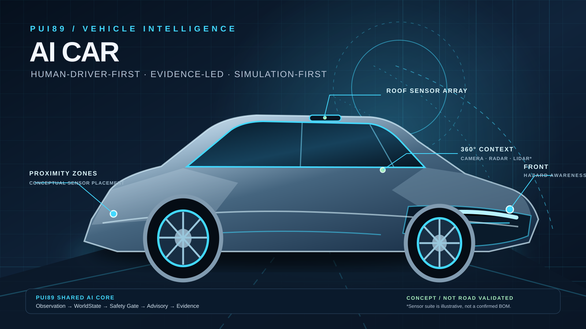

# PUI89 AI Robot Car

**Repository:** `Pui89/ai-robot-car`  
**Project type:** Advanced AI-enabled vehicle intelligence and robotics research; software-first, simulation-first.  
**Status:** Early-stage software scaffold. Not a built, road-tested, autonomous, or road-certified vehicle.

## Design concept

The concept uses a premium electric crossover form in PUI89 deep navy and electric cyan. The illustrative sensor layout communicates a future perception envelope (camera, radar, lidar and proximity sensing), while the software architecture remains human-driver-first: AI produces evidence-linked advisories, not steering, throttle or braking commands.

**The artwork is a design visualization, not a production CAD model, bill of materials, verified sensor layout, built prototype, or performance claim.** Sensor selection and physical packaging remain future engineering work.

## Mission

Develop a safety-first vehicle intelligence platform for environmental awareness, hazard detection, vehicle-health monitoring, predictive maintenance, and explainable driver assistance. A human driver remains responsible for vehicle control. This repository has no physical vehicle integration or actuator authority.

## PUI89 engineering rules

- **Strict zero-cost:** no paid APIs, subscriptions, cloud GPUs, paid datasets, metered services, or unexpected billing.
- **Simulation first:** no physical vehicle, ECU, vehicle-bus or actuator connections.
- **Safety before features:** uncertainty, human review, conservative failure handling and hazard analysis are mandatory.
- **Evidence before claims:** distinguish proposed, implemented, simulation-tested, bench-tested and independently validated capabilities.
- **Shared AI Core:** reuse canonical PUI89 contracts and services; local compatibility types are temporary and must not become a competing core.
- **Security by default:** least privilege, dependency/provenance review, protected changes and no secrets in source.
- **No unsupported autonomous-driving, roadworthiness, waterproofing, fire-resistance or safety claims.**

## Capability research areas

1. Environmental perception and hazard-awareness research.
2. Human-facing driver-assistance concepts.
3. Vehicle-health and predictive-maintenance research.
4. Road, weather and visibility context using documented lawful data or simulation.
5. Agentic analysis with evidence and human oversight.
6. SHIELD risk monitoring, stale-data handling and conservative degradation.

## Working concept architecture

`Observation → WorldState → Hazard Analysis → Safety Gate → Human-facing Advisory → Evidence Record`

- Inputs must preserve source, timestamp, quality, confidence, provenance and freshness.
- Missing, stale, conflicting or out-of-range inputs must not be silently treated as facts.
- Uncertainty must propagate to the advisory output.
- Every advisory should carry its rationale, evidence references, limitations and escalation path.
- The AI layer has no direct authority over steering, throttle, braking or propulsion.

## Development stages

1. Define requirements, hazards, operating boundaries and shared AI Core interfaces.
2. Build software-only contracts and deterministic safety gates.
3. Create synthetic scenarios and simulation adapters.
4. Add evaluation, robustness, security and regression tests.
5. Consider hardware only after qualified engineering, safety, cybersecurity and legal review.

## Repository map

- `docs/PROJECT_PLAN.md` — scope and staged roadmap.
- `docs/AI_ARCHITECTURE.md` — software architecture and data flow.
- `docs/AGENTIC_AI_SYSTEM.md` — agent roles and authority boundaries.
- `docs/UNIVERSAL_SHIELD.md` — cross-project safety and resilience standard.
- `docs/AUTONOMOUS_SIMULATION.md` — simulation-only research plan.
- `docs/PREDICTIVE_MAINTENANCE.md` — health and maintenance research.
- `docs/SAFETY_CASE.md` — hazards and safeguards.
- `docs/THREAT_MODEL.md` and `SECURITY.md` — security risks and reporting.
- `docs/AI_BENCHMARKS.md` — reproducible evaluation protocol.
- `docs/IMPLEMENTATION_STATUS.md` — implemented, missing and next work.
- `pui89_car/` — dependency-free local compatibility prototype and safety gates.
- `tests/` — standard-library unit tests.
- `.github/workflows/quality.yml` — automated documentation, test and compile checks.

## Free AI and advanced engineering resources

See [PUI89 Free AI & Advanced Engineering Stack](docs/FREE_AI_TECH_STACK.md). Every tool, model, dataset and hosted feature requires exact licence, provenance, hardware and cost review before adoption. Free software does not guarantee free model weights, compute, datasets or commercial rights.

## Current truth

This repository contains research documentation and an initial software-only contract/safety prototype. It does not contain a functioning car, validated perception model, real-time vehicle integration, autonomous driving capability, or certified safety system. The local contract types are provisional until aligned with the canonical shared PUI89 AI Core.

## PUI89 portfolio links

- **English project page:** [PUI89 AI Car](https://pui89.github.io/ai-robot-car.html)
- **Thai project page:** [PUI89 AI Car — ภาษาไทย](https://pui89.github.io/ai-robot-car-th.html)
- **PUI89 main portfolio:** [https://pui89.github.io/](https://pui89.github.io/)
- **Website source repository:** [Pui89/Pui89.github.io](https://github.com/Pui89/Pui89.github.io)
- **Motorcycle companion project:** [PUI89 AI Robot Motorcycle — EasyRide](https://github.com/Pui89/ai-robot-motorcycle)

## License

This project is licensed under the **Apache License 2.0**. See the [LICENSE](LICENSE) file.

Unless a file or component states otherwise, the Apache-2.0 licence applies to the original project materials in this repository. Third-party datasets, model weights, images, trademarks and other externally sourced assets retain their own licences and terms; check their provenance before use or redistribution.

Copyright 2026 Pui89.

## Hugging Face vision models — opt-in local integration

This repository now includes real Hugging Face checkpoint adapters in [`pui89_models/hf_vision.py`](pui89_models/hf_vision.py), with project-specific usage boundaries in [`docs/HUGGING_FACE_MODEL_INTEGRATION.md`](docs/HUGGING_FACE_MODEL_INTEGRATION.md).

- **OWLv2:** `google/owlv2-base-patch16-ensemble` for text-conditioned object proposals.
- **Depth Anything V2 Small:** `depth-anything/Depth-Anything-V2-Small-hf` for relative scene depth where appropriate; not calibrated distance or physical depth.
- **Zero-cost default:** no packages or model weights are installed/downloaded automatically; CPU-only inference, local cache only by default, no hosted inference API or cloud GPU.
- **Evidence status:** adapter code is added; model inference and project-specific accuracy are NOT YET TESTED. Outputs remain uncertain observations for human review, never actuator commands.
